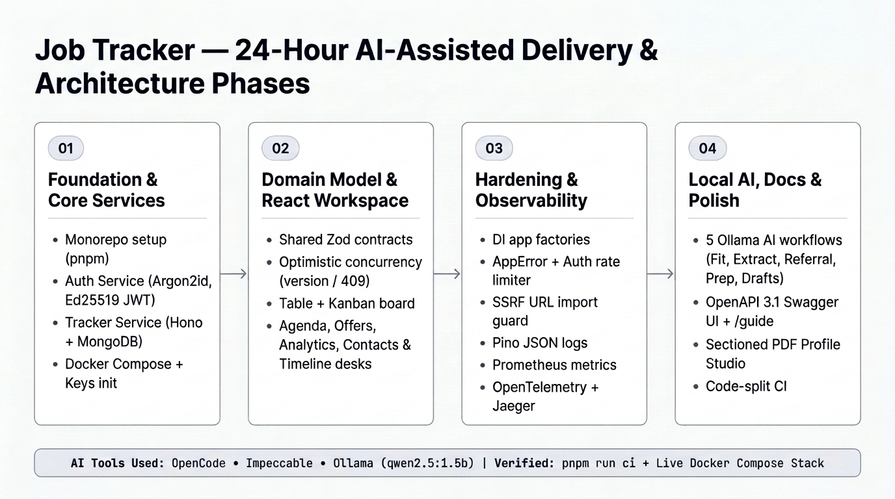
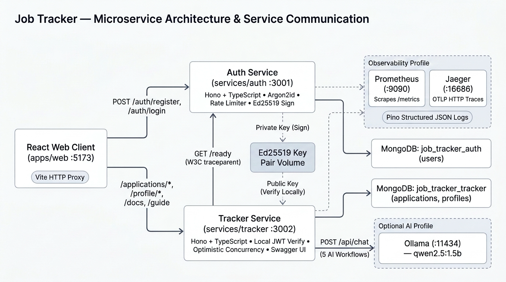
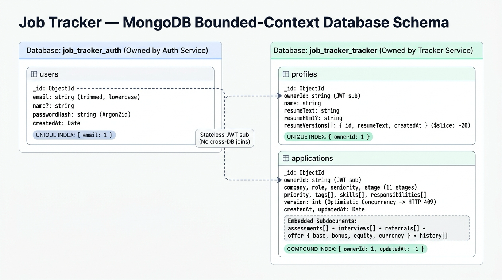

# Evaluation & Architecture Deep Dive

This document maps the **Job Tracker** repository directly to each evaluation criterion: **Architecture**, **Engineering Best Practices**, **Security**, **Observability**, **Database Schema**, and **24-Hour Delivery Phases**.

---

## 1. Planning & 24-Hour Delivery Phases



All commits were authored within the 24-hour evaluation window starting from the initial scaffold commit (`93fe960`), progressing through four clean phases:
1. **Foundation & Core Services:** pnpm TypeScript monorepo, `services/auth` (Argon2id + Ed25519 JWT), `services/tracker` (Hono + MongoDB), Docker Compose with automated key generation.
2. **Domain Model & React Workspace:** Centralized shared Zod contracts (`packages/application-options`), atomic optimistic concurrency (`version` / HTTP `409`), Table + Kanban pipeline views, Agenda, Attention alerts, Recruiter directory, Multi-currency Offers, Analytics, Activity timeline, CSV/JSON export & bulk import.
3. **Hardening & Observability:** Pure DI app factories, centralized `AppError` middleware, Auth IP rate limiting, SSRF-protected job URL importer, Pino JSON logging with secret redaction, Prometheus metrics, OpenTelemetry + Jaeger distributed tracing.
4. **Local AI, Docs & Polish:** Five optional Ollama (`qwen2.5:1.5b`) workflows, OpenAPI 3.1 Swagger UI (`/docs`, `/auth/docs`) + `/guide`, split-screen PDF + 7-section shadcn RHF/Zod Profile Studio, dropdown rich-text editor, and Rolldown code-splitting.

---

## 2. Architecture & Service Communication



### Workspace Structure
```text
├── apps/web                        # React 19 + Vite 8 + Tailwind v4 + shadcn/React Aria UI
├── services/auth                   # Identity microservice (port 3001)
│   └── src/{app.ts,config.ts,main.ts,openapi.ts,auth/*}
├── services/tracker                # Core domain & AI microservice (port 3002)
│   └── src/{app.ts,config.ts,main.ts,openapi.ts,guide.ts,auth/*,profile/*,applications/*}
├── packages/application-options    # Shared enums, Zod schemas, clearable keys, API DTOs
└── packages/observability          # Pino logger, AppError, security headers, Swagger, Prometheus, OTel
```

### Communication Patterns
- **Asymmetric Stateless Auth:** `keys` init container creates an Ed25519 key pair in `signing-keys`. `auth` signs 15-minute JWTs with the private key; `tracker` verifies them locally with the public key (`services/tracker/src/auth/require-auth.ts`).
- **Cross-Service Dependency Probe:** `GET /ready/dependencies` on Tracker calls Auth's `GET /ready` with bounded timeouts and W3C `traceparent` propagation (`services/tracker/src/system/auth-readiness.ts`).
- **Optional Local LLM Channel:** Tracker calls `POST ${OLLAMA_BASE_URL}/api/chat` (`http://ollama:11434` in Compose) with structured JSON schemas, exponential backoff retries on transient 5xx/network failures, and OpenTelemetry `CLIENT` child spans (`services/tracker/src/applications/ai/ollama.ts`).

---

## 3. Engineering Best Practices

- **Single Source of Truth:** All stage/priority/work-model/assessment/interview/referral enums, `clearableApplicationKeys`, Zod schemas, and TypeScript types live once in `packages/application-options` (`options.ts`, `schemas.ts`, `contracts.ts`).
- **Dependency Injection & Pure App Factories:** `createAuthApp` (`services/auth/src/app.ts`) and `createTrackerApp` (`services/tracker/src/app.ts`) accept injected DB collections, token verifiers, and AI runtime options, enabling fast hermetic HTTP tests without filesystem key coupling.
- **Centralized Error Handling:** `AppError` + `registerErrorHandlers` (`packages/observability/index.ts`) returns consistent `{ error, code, issues? }` JSON responses with structured Pino error logs linked to `traceId`/`spanId`.
- **Fail-Fast Configuration & Graceful Shutdown:** Both services validate env vars at startup with Zod (`services/auth/src/config.ts`, `services/tracker/src/config.ts`) and close HTTP servers, OpenTelemetry SDKs, and `MongoClient` cleanly on `SIGINT`/`SIGTERM`.
- **Interactive API Documentation:** OpenAPI 3.1 specs are generated directly from shared Zod schemas (`services/tracker/src/openapi.ts`, `services/auth/src/openapi.ts`) and served with Swagger UI at `/docs`, `/auth/docs`, and a standalone usage guide at `/guide`.
- **Testing & CI (`pnpm run ci`):** Runs `oxlint`, recursive TypeScript typechecking (`tsc --noEmit` / `tsc -b`), 20 unit & HTTP route integration tests (`services/auth/test/*`, `services/tracker/test/*`), and clean `rm -rf dist && tsc` + Rolldown code-split Vite builds (`163 kB` entry JS, zero chunk-size warnings).

---

## 4. Security & Protections

| Layer | Implementation | Location |
|---|---|---|
| **Password Hashing** | Argon2id (`@node-rs/argon2`) | `services/auth/src/auth/procedures.ts` |
| **Token Signing & Verification** | 15m Ed25519 (`EdDSA`) JWT verifying `alg`, `iss`, `aud`, `sub`, `exp` | `services/auth/src/main.ts`, `services/tracker/src/auth/require-auth.ts` |
| **Tenant Isolation** | Every query/mutation filters by verified `ownerId` from JWT `sub` | `services/tracker/src/applications/procedures.ts` |
| **Rate Limiting** | Sliding-window IP rate limiter (`429` + `Retry-After`) on `/auth/*` | `services/auth/src/auth/rate-limit.ts` |
| **Input & Body Guards** | `z.strictObject` schemas (rejects `ownerId` spoofing) + body limits (`16 KB` / `256 KB` / `1 MB`) | `packages/application-options/schemas.ts`, `routes.ts` |
| **SSRF Protection** | Blocks non-HTTP(S), credentialed URLs, loopback/private/link-local IPs via `ipaddr.js` | `services/tracker/src/applications/posting-import/fetch-page.ts` |
| **HTTP Security Headers** | `X-Content-Type-Options: nosniff`, `X-Frame-Options: DENY`, `Referrer-Policy: no-referrer`, `Cache-Control: no-store` | `packages/observability/index.ts` |
| **Log Redaction** | Pino automatically redacts `Authorization`, `password`, and `accessToken` | `packages/observability/index.ts` |
| **AI Prompt Safety** | All user/posting/resume content passed strictly as JSON data; outputs validated via Zod; never auto-sends | `services/tracker/src/applications/ai/*` |

---

## 5. Observability (Logging, Traces & Metrics)

- **Pino Structured JSON Logs:** Every request logs `service`, `requestId`, `method`, `route`, `status`, `durationMs`, and active `traceId`/`spanId`, configurable via `LOG_LEVEL`.
- **Prometheus Metrics (`/metrics`):**
  - `http_requests_total{method,route,status}` & `http_request_duration_seconds`
  - `ai_requests_total{operation,status}` & `ai_request_duration_seconds{operation}`
- **OpenTelemetry + Jaeger:** Exports OTLP HTTP traces for incoming HTTP requests, `tracker -> auth` readiness checks, and `ollama.<operation>` local LLM calls.

---

## 6. Database Schema (MongoDB)



- **Bounded-Context Isolation:** Auth uses `job_tracker_auth`; Tracker uses `job_tracker_tracker`. No shared tables or cross-service DB reads.
- **Indexes:**
  - `users`: `{ email: 1 }` (`unique: true`)
  - `profiles`: `{ ownerId: 1 }` (`unique: true`)
  - `applications`: `{ ownerId: 1, updatedAt: -1 }`
- **Embedding & Atomic Concurrency:** Sub-entities (`assessments`, `interviews`, `referrals`, `offer`, `history`) are embedded inside each `application` document so reads require zero joins and `PATCH /applications/:id` atomically checks `{ ownerId, _id, version }`, increments `version`, unsets cleared fields, and appends stage `history` in a single MongoDB write (returning HTTP `409` on concurrent conflicts).
- **Bounded Version History:** `profiles.resumeVersions` uses `$push` with `$slice: -20` to prevent unbounded document growth.

---

## 7. AI Tools Used

- **OpenCode** — AI-assisted architecture planning, implementation, refactoring, and testing.
- **Impeccable** — Frontend design system and UI craft guidance (`apps/web/DESIGN.md`).
- **Ollama (`qwen2.5:1.5b`)** — Optional local runtime model for the five editorial AI workflows.
