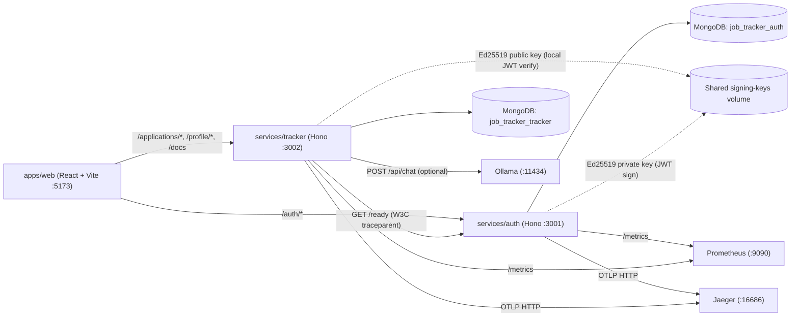

# Job Tracker

A local-first TypeScript microservice workspace for managing a job search end to end: 11-stage application pipeline tracking, deterministic resume skill-coverage scoring, chronological deadline agendas, coding assessments, interview rounds, referrals, multi-currency offer comparison, sectioned PDF resume editing, and optional local Ollama AI workflows.

## Quick start (run locally)

Install and open Docker Desktop, then run:

```sh
docker compose up --build
```

Optional profiles add local AI (Ollama + `qwen2.5:1.5b`) and full observability (Prometheus + Jaeger):

```sh
# Core stack + local Ollama AI
docker compose --profile ai up --build -d
docker compose --profile ai logs -f ollama-init

# Full stack (Core + AI + Prometheus & Jaeger tracing)
OTEL_EXPORTER_OTLP_TRACES_ENDPOINT=http://jaeger:4318/v1/traces \
  docker compose --profile ai --profile observability up --build -d
```

Open [http://localhost:5173](http://localhost:5173) to use the app, or explore the live documentation:

| Surface | URL | Purpose |
|---|---|---|
| **Web Workspace** | [http://localhost:5173](http://localhost:5173) | React + Vite UI (proxies `/auth`, `/applications`, `/profile`, `/docs`, `/guide`) |
| **Usage & Operations Guide** | [http://localhost:5173/guide](http://localhost:5173/guide) | Walkthrough, curl examples, AI reference, and observability guide |
| **Tracker Swagger UI** | [http://localhost:5173/docs](http://localhost:5173/docs) | Interactive OpenAPI 3.1 explorer ([`/openapi.json`](http://localhost:5173/openapi.json)) |
| **Auth Swagger UI** | [http://localhost:5173/auth/docs](http://localhost:5173/auth/docs) | Interactive OpenAPI 3.1 explorer ([`/auth/openapi.json`](http://localhost:5173/auth/openapi.json)) |
| **Prometheus** | [http://127.0.0.1:9090](http://127.0.0.1:9090) | HTTP & AI metrics (`--profile observability`) |
| **Jaeger** | [http://127.0.0.1:16686](http://127.0.0.1:16686) | Distributed traces across services (`--profile observability`) |

Stop with `docker compose down`. Account data, applications, and pulled Ollama models persist in Docker volumes.

### Native Node.js development

With Node.js 26 and pnpm 12 installed:

```sh
pnpm install --frozen-lockfile
docker compose up -d mongo
node --input-type=module <<'JS'
import { generateKeyPairSync } from "node:crypto";
import { mkdirSync, writeFileSync } from "node:fs";
mkdirSync(".local", { recursive: true, mode: 0o700 });
const { privateKey, publicKey } = generateKeyPairSync("ed25519", {
  privateKeyEncoding: { type: "pkcs8", format: "pem" },
  publicKeyEncoding: { type: "spki", format: "pem" },
});
writeFileSync(".local/auth-private.pem", privateKey, { mode: 0o600, flag: "wx" });
writeFileSync(".local/auth-public.pem", publicKey, { flag: "wx" });
JS
```

Run `pnpm --filter @job-tracker/auth dev`, `pnpm --filter @job-tracker/tracker dev`, and `pnpm --dir apps/web dev` in separate terminals. Run `pnpm run ci` to execute lint, typecheck, tests, and production builds across all workspace packages.

---

## Architecture & service communication



### Service boundaries & communication
- **Auth Service (`services/auth`, port `3001`):** Owns identity, password hashing (Argon2id), and short-lived Ed25519 JWT issuance (`15m`, `iss: job-tracker-auth`, `aud: job-tracker-api`).
- **Tracker Service (`services/tracker`, port `3002`):** Owns user profiles, job applications, deterministic resume matching, posting import, agenda/offer synthesis, and local Ollama AI workflows.
- **Stateless trust boundary:** A dedicated Compose `keys` init container generates an Ed25519 key pair into a shared read-only volume. Auth signs JWTs with the private key; Tracker verifies them locally with the public key—eliminating synchronous auth round-trips on every request while preserving strict service isolation.
- **Cross-service HTTP & tracing:** Tracker exposes `GET /ready/dependencies`, calling Auth's `GET /ready` with bounded timeouts and W3C `traceparent` header propagation so Jaeger displays the full multi-service trace.
- **Shared workspace packages:**
  - `packages/application-options`: Single source of truth for enums, `clearableApplicationKeys`, Zod schemas, and TypeScript DTO contracts shared by `services/tracker` and `apps/web`.
  - `packages/observability`: Shared Pino logger, centralized `AppError` / Hono `onError` middleware, security headers, Swagger/OpenAPI registration, Prometheus metrics, OpenTelemetry tracing, and `SIGINT`/`SIGTERM` graceful shutdown.

---

## Database design (MongoDB)

Each service owns a separate MongoDB database to enforce strict bounded-context data isolation:

### 1. `job_tracker_auth.users` (owned by Auth)
- **Document fields:** `_id`, `email` (trimmed & lowercased), `name` (optional), `passwordHash` (Argon2id), `createdAt`.
- **Indexes:** `{ email: 1 }` (`unique: true`).

### 2. `job_tracker_tracker.profiles` (owned by Tracker)
- **Document fields:** `_id`, `ownerId` (JWT `sub`), `name`, `resumeText`, `resumeHtml` (optional), `resumeVersions` (bounded rolling array via `$slice: -20` storing `{ id, resumeText, resumeHtml, createdAt }`).
- **Indexes:** `{ ownerId: 1 }` (`unique: true`).

### 3. `job_tracker_tracker.applications` (owned by Tracker)
- **Document fields:** `_id`, `ownerId`, `company`, `role`, `seniority`, `stage` (11 pipeline stages), `priority`, `tags` (deduplicated), `skills`, `responsibilities`, `location`, `workModel`, `salaryRange`, `jobUrl`, `description` (+ `descriptionHtml`), `notes` (+ `notesHtml`), `resumeText` (+ `resumeTextHtml`), `coverLetter` (+ `coverLetterHtml`), `appliedAt`, `deadline`, `followUp`, `rejectionReason`, `version` (monotonic integer), `createdAt`, `updatedAt`.
- **Embedded subdocuments:** `assessments[]`, `interviews[]`, `referrals[]`, `offer`, and `history[]` (`{ from?, to, at }`). Embedding keeps each application self-contained for atomic single-document reads and writes without cross-collection joins.
- **Indexes:** `{ ownerId: 1, updatedAt: -1 }`.
- **Optimistic concurrency:** Every `PATCH /applications/:id` filters by `{ ownerId, _id, version }` and executes `$set`, `$inc: { version: 1 }`, `$unset`, and `$push: { history }` atomically in one `findOneAndUpdate`. Competing/stale writes return HTTP `409 CONFLICT`.

---

## Security & engineering best practices

- **Authentication & authorization:** Argon2id password hashing, 15-minute Ed25519 JWTs validating `alg`, `iss`, `aud`, `sub`, and `exp`, and mandatory `ownerId` scoping on every Tracker read/write/delete.
- **Abuse & injection protections:**
  - Sliding-window IP rate limiter (`429` + `Retry-After`) on `/auth/register` and `/auth/login`.
  - Strict request body size limits (`16 KB` on Auth, `256 KB` on Profile, `1 MB` on Applications).
  - Strict Zod input validation (`z.strictObject`) rejecting unknown keys (such as client-supplied `ownerId`).
  - SSRF protection on `POST /applications/import` rejecting non-HTTP(S), credentialed URLs, and loopback/private/link-local IPs via `ipaddr.js`.
  - Security headers on all responses (`X-Content-Type-Options: nosniff`, `X-Frame-Options: DENY`, `Referrer-Policy: no-referrer`, `Cache-Control: no-store`).
  - Prompt-injection boundaries on all local Ollama calls (all user/posting/resume content passed strictly as JSON data; structured outputs validated via Zod; never auto-sends messages).
- **Code quality & testability:** Pure dependency-injected Hono app factories (`createAuthApp`, `createTrackerApp`), fail-fast Zod env configuration (`config.ts`), centralized `AppError` codes, graceful `SIGINT`/`SIGTERM` shutdown, Rolldown code-split frontend (`163 kB` entry JS), and hermetic unit + HTTP route integration tests (`pnpm run ci`).

---

## Observability (logging, traces & metrics)

- **Structured logging (Pino):** Both services emit ISO-timestamped JSON logs with `service`, `requestId`, `traceId`, `spanId`, route, status, and duration, with automatic `[REDACTED]` scrubbing of `Authorization` headers, passwords, and tokens (`LOG_LEVEL` configurable).
- **Metrics (Prometheus):** `/metrics` on Auth and Tracker exposes `http_requests_total`, `http_request_duration_seconds`, `ai_requests_total{operation,status}`, and `ai_request_duration_seconds{operation}`.
- **Distributed tracing (OpenTelemetry + Jaeger):** Incoming HTTP server spans, outbound `tracker -> auth` readiness spans, and `ollama.<operation>` AI client spans propagate W3C trace context and export over OTLP HTTP to Jaeger.

```sh
# Trigger a cross-service distributed trace
docker compose exec -T tracker node --input-type=module -e \
  'const r = await fetch("http://127.0.0.1:3002/ready/dependencies"); console.log(r.status, await r.text())'
docker compose logs --tail=10 tracker auth
```

---

## Local AI workflows (optional Ollama profile)

Resume matching (`GET /applications/:id/match`) stays **100% deterministic and reproducible** (`strong = 1`, `partial = 0.5`, `missing = 0`). With `--profile ai`, Tracker adds five editorial workflows over `OLLAMA_BASE_URL` (with OpenTelemetry spans and transient retry/backoff):

1. **AI job-fit explanation** (`POST /applications/:id/match/explain`) — evidence-backed strengths, resume gaps, and prep priorities alongside the unchanged deterministic score.
2. **Job description extraction** (`POST /applications/extract`) — editable suggestions for required skills, responsibilities, and seniority.
3. **Referral draft** (`POST /applications/:id/referrals/:referralId/draft`) — concise editable referral message for a saved contact.
4. **Interview prep** (`POST /applications/:id/interview-prep`) — role-specific study topics and practice questions from saved posting details and resume gaps.
5. **Cover-letter & follow-up drafts** (`POST /applications/:id/cover-letter/draft`, `POST /applications/:id/follow-up/draft`) — editable drafts strictly from saved facts, leaving the user in full control of sending.

---

## AI tools & models used

- **Codex (OpenAI):** Initial architecture planning, Auth/Tracker scaffolding, deterministic resume matcher, posting import, observability setup, and testing.
- **Antigravity (Google DeepMind):** All 5 Ollama AI workflows, shared `@job-tracker/application-options` contracts, DI app factories & graceful shutdown, Pino logging, OpenAPI 3.1 Swagger UI & `/guide`, HTTP route integration tests, sectioned PDF Profile Studio, and dropdown rich-text editor redesign.
- **OpenCode:** Attention/follow-up desk, recruiter directory, full activity timeline, CSV/JSON export & bulk import, resume-version linking, and custom time picker.
- **Impeccable:** Frontend design system guidance (`apps/web/DESIGN.md`).
- **Runtime local model:** Ollama (`qwen2.5:1.5b`, optional via `--profile ai`).
