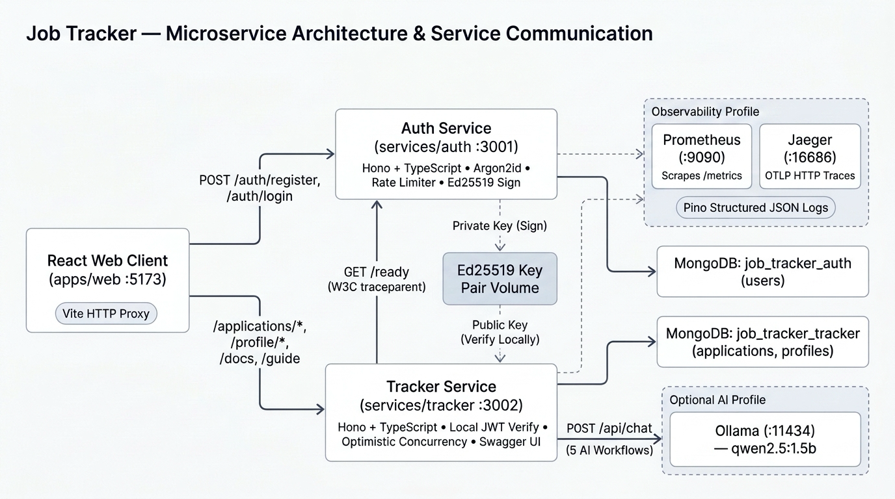
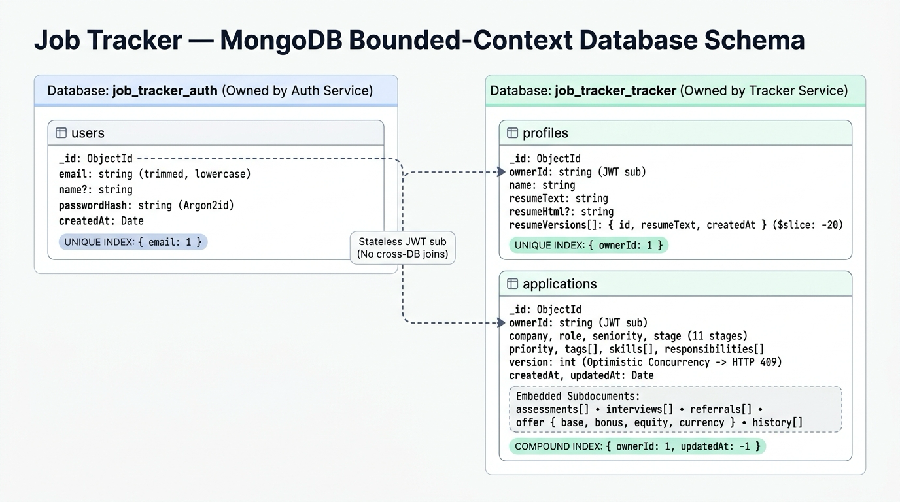

# Job Tracker

A local-first TypeScript microservice workspace for managing a job search end to end — built with **Auth** and **Tracker** Hono microservices, **MongoDB**, **React**, **OpenTelemetry / Prometheus / Pino**, and optional local **Ollama** AI workflows.

> For a full rubric-by-rubric breakdown (engineering practices, security protections, observability, database rationale, and delivery phases), see **[EVALUATION.md](./EVALUATION.md)**.

## Architecture & Service Communication



- **Auth Service (`services/auth`, port `3001`):** Owns user accounts, Argon2id password hashing, IP rate limiting, and 15-minute Ed25519 JWT issuance.
- **Tracker Service (`services/tracker`, port `3002`):** Owns user profiles, job applications, deterministic resume matching, posting import, agenda/offer synthesis, and optional local Ollama AI workflows.
- **Stateless Trust Boundary:** A Compose `keys` init container generates an Ed25519 key pair into a shared read-only volume. Auth signs tokens with the private key; Tracker verifies them locally with the public key—avoiding synchronous Auth lookups on every request. Cross-service HTTP communication (`GET /ready/dependencies`) propagates W3C `traceparent` headers to Jaeger.
- **React Client (`apps/web`, port `5173`):** Connects to both services through Vite's HTTP proxy (`/auth`, `/applications`, `/profile`, `/docs`, `/guide`, `/openapi.json`).

## Database Design (MongoDB)



Each service owns a separate MongoDB database:

- **`job_tracker_auth.users`:** Stores normalized emails (`{ email: 1 }` unique index) and Argon2id password hashes.
- **`job_tracker_tracker.profiles`:** Isolated by `{ ownerId: 1 }` unique index; stores resume text and a rolling `$slice: -20` `resumeVersions[]` history.
- **`job_tracker_tracker.applications`:** Indexed by `{ ownerId: 1, updatedAt: -1 }`. Embeds `assessments[]`, `interviews[]`, `referrals[]`, `offer`, and `history[]` so updates stay atomic. Every `PATCH` checks `{ ownerId, _id, version }` and increments `version` in a single `findOneAndUpdate`, returning HTTP `409` on conflict.

## Run Locally

Requires Docker Desktop:

```sh
# Core stack (MongoDB, Auth, Tracker, React Web UI)
docker compose up --build

# Optional: enable local Ollama AI workflows (qwen2.5:1.5b)
docker compose --profile ai up --build -d

# Optional: enable Prometheus & Jaeger distributed tracing
OTEL_EXPORTER_OTLP_TRACES_ENDPOINT=http://jaeger:4318/v1/traces \
  docker compose --profile ai --profile observability up --build -d
```

Once running:

- **Web App:** [http://localhost:5173](http://localhost:5173)
- **Usage Guide:** [http://localhost:5173/guide](http://localhost:5173/guide)
- **Tracker Swagger UI:** [http://localhost:5173/docs](http://localhost:5173/docs)
- **Auth Swagger UI:** [http://localhost:5173/auth/docs](http://localhost:5173/auth/docs)
- **Prometheus / Jaeger:** [http://127.0.0.1:9090](http://127.0.0.1:9090) · [http://127.0.0.1:16686](http://127.0.0.1:16686)

Stop with `docker compose down` (data persists in Docker volumes). Run `pnpm run ci` locally for lint, typecheck, tests, and production builds.

## AI Tools Used

- **OpenCode** — AI-assisted architecture planning, TypeScript implementation, refactoring, and testing.
- **Impeccable** — Frontend design system and UI craft guidance.
- **Ollama (`qwen2.5:1.5b`)** — Optional local runtime LLM for job-fit explanations, posting extraction, interview prep, and editable outreach drafts.
